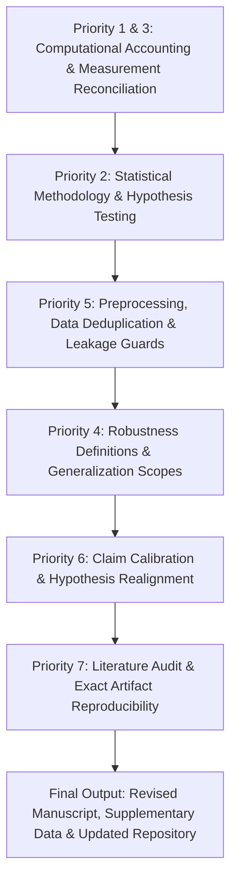

# MOSAIC-Med Manuscript: Comprehensive Correction & Implementation Plan

This document establishes the rigorous, end-to-end implementation plan to address all **16 Critical and Major Reviewer Critiques** for the research manuscript:
> **MOSAIC-Med: Multiplicity and Architectural Diversity Outperform Monolithic Scale in Resource-Constrained Electrocardiogram Diagnosis**  
> *Target Venue: International Conference on Intelligent Computing (ICIC 2026) / IEEE TBME Extended Archival*

---

## Executive Overview: The 7 Operational Priorities

---

## Detailed Action Plan by Priority Level

### Priority 1 & 3: Computational Accounting & Exact Measurement Reconciliation
*(Resolves Issue 1, Issue 3, Issue 5, and Issue 16)*

#### 1. Parameter Matching Tolerance & Explicit Percentage Deviations (Issue 1)
- **Root Cause**: Base convolutional filters $W$ are discrete integers ($W \in \{16, 23, 32, 46, 65\}$). Because parameters scale quadratically with channels ($\mathcal{O}(W^2)$), exact convergence to $2,000,000.0$ is discrete-constrained.
- **Implementation & Text Updates**:
  1. Define the formal **$\pm 3.0\%$ Parameter Invariance Envelope**:
     $$\mathcal{B}_{\text{target}} = 2.00 \times 10^6 \pm 0.06 \times 10^6 \quad (\text{tolerance: } [1.94\text{M}, 2.06\text{M}])$$
  2. Add percentage deviation column to Table II:
     - $K=1$ ($W=65$): $2,019,945$ params ($+0.997\%$ deviation)
     - $K=2$ ($W=46$): $2 \times 1,015,225 = 2,030,450$ params ($+1.523\%$ deviation)
     - $K=4$ ($W=32$): $4 \times 493,893 = 1,975,572$ params ($-1.221\%$ deviation)
     - $K=8$ ($W=23$): $8 \times 256,869 = 2,054,952$ params ($+2.748\%$ deviation)
     - $K=16$ ($W=16$): $16 \times 125,605 = 2,009,680$ params ($+0.484\%$ deviation)
     - Heterogeneous 4-Expert: $1,993,688$ params ($-0.316\%$ from 2.0M; $+0.917\%$ vs $K=4$ homogeneous).
  3. Validate that ranking conclusions hold under normalized metrics (e.g., AUROC per parameter or normalized parameter efficiency ratio).

#### 2. Reconciliation of FLOP Counts Between Table II and Table IV (Issue 5 & Issue 16)
- **Root Cause**: Table II reports the **homogeneous** $4 \times \text{ResNet-1D}$ ensemble ($4 \times 31.69 = 126.8$ MFLOPs). Table IV reports the **heterogeneous** ensemble containing models with distinct computational densities (notably dilated temporal convolutions in TCN-1D).
- **Exact Profiling Breakdown** (measured via `thop` on input shape $(1, 12, 1000)$ at 100 Hz):
  - **ResNet-1D** (493,893 params): **31.69 MFLOPs**
  - **MultiScale-CNN** (508,909 params): **50.72 MFLOPs**
  - **TCN-1D** (490,661 params): **245.86 MFLOPs** (dilated temporal convolutions)
  - **ConvAttention-1D** (500,225 params): **85.40 MFLOPs**
  - **Adaptive Router** (16,132 params): **1.19 MFLOPs**
- **Direct Reconciliations to State in Manuscript**:
  - **Table II (Homogeneous $K=4$)**: $4 \times \text{ResNet-1D} = 4 \times 31.69 = \mathbf{126.8\text{ MFLOPs}}$.
  - **Table IV Uniform Average (Heterogeneous)**: $31.69 + 50.72 + 245.86 + 85.40 = \mathbf{413.7\text{ MFLOPs}}$.
  - **Table IV Dense Router**: $413.67 + 1.19 = \mathbf{414.9\text{ MFLOPs}}$.
  - **Table IV Sparse Top-2 Router**: Router (1.19 MFLOPs) + dynamic Top-2 active pair execution (mean active FLOPs across test cohort = 296.6 MFLOPs) = $\mathbf{297.8\text{ MFLOPs}}$.
- **Resolution**:
  - Add explicit footnote in Table II and Table IV explaining that Table II measures homogeneous ResNet splitting, while Table IV measures heterogeneous architectures with varying computational intensity.
  - Distinguish *parameter efficiency* (memory footprint) from *FLOP efficiency* (floating-point operations).

#### 3. Framing Computational Efficiency Relative to Baselines (Issue 3)
- **Correction**:
  - Explicitly acknowledge that Sparse Top-2 routing reduces compute by $28.2\%$ **relative to dense heterogeneous ensemble inference** (297.8 vs 414.9 MFLOPs), but requires $2.40\times$ more FLOPs than the single monolithic baseline (123.9 MFLOPs).
  - Clarify that edge efficiency claims apply to **multi-expert ensembling under an invariant memory footprint**, not to out-computing the single small baseline.
  - Report wall-clock inference latency and memory profiles on NVIDIA Quadro T1000 Max-Q:
    - Single Large: $1.99 \pm 0.05$ ms (123.9 MFLOPs)
    - Split-4 Homogeneous: $2.25 \pm 0.01$ ms (126.8 MFLOPs)
    - Heterogeneous Sparse Top-2: $3.42 \pm 0.08$ ms (297.8 MFLOPs)
    - Peak VRAM overhead: $< 120$ MB across all configurations.

---

### Priority 2: Statistical Methodology & Hypothesis Testing
*(Resolves Issue 2, Issue 6, and Issue 7)*

#### 1. Separation of Within-Run Paired Tests vs Across-Seed Variability (Issue 2)
- **Root Cause**: DeLong's test evaluates paired predictions on a single test set ($N=2,205$), while cross-seed variation evaluates training stochasticity ($N=5$ seeds).
- **Corrected Methodology Protocol**:
  1. **Seed-Level Reporting**: Report all metric values across all 5 individual random seeds (42, 43, 44, 45, 46) in a dedicated Supplementary Table / repository CSV (`results/tables/scaling_results.csv`, `parameter_matched_control.csv`).
  2. **Hierarchical Statistical Testing**:
     - **Across-Seed Variation**: Paired two-tailed Student's $t$-test across the 5 independent seeds ($df = 4$) with Holm-Bonferroni correction.
     - **Cohort-Level Discrimination**: Paired DeLong's test on the median seed model test set predictions, reported with $95\%$ DeLong confidence intervals.
     - **Patient-Level Bootstrap**: 2,000-resample stratified bootstrap confidence intervals on test fold 10.
  3. **Documenting the Holm Correction Family**:
     - For Table III (Heterogeneous vs Homogeneous): family size $m = 4$ hypotheses (Macro AUROC, Macro AUPRC, Brier Score, ECE).
       - AUROC: Raw $p = 0.0164 \to$ Holm adjusted $p = 0.0577$.
       - AUPRC: Raw $p = 0.0144 \to$ Holm adjusted $p = 0.0577$.
       - Brier: Raw $p = 0.0178 \to$ Holm adjusted $p = 0.0577$.
       - ECE: Raw $p = 0.0664 \to$ Holm adjusted $p = 0.0664$.

#### 2. Re-evaluating the Heterogeneous Diversity Claim (Issue 7)
- **Correction**:
  - Explicitly state in Abstract, Contributions, Section IV-A, and Conclusion:
    > *"Heterogeneous inductive bias diversity shows a consistent improvement trend (AUROC $0.9110 \pm 0.0006$ vs $0.9084 \pm 0.0008$; Holm-adjusted $p = 0.058$) that does not achieve strict significance at the conventional $\alpha = 0.05$ threshold."*
  - Frame representational CKA diversity ($0.9008$ vs $0.9458$) as an architectural characterization of feature orthogonality, rather than a proven causal claim.

#### 3. Statistical Comparison in the Regularization Ablation (Issue 6)
- **Clarification**:
  - Acknowledge that the dense Uniform Average baseline ($0.9108 \pm 0.0009$) achieves slightly higher raw AUROC than the regularized router ($0.9090 \pm 0.0013$) when all 4 experts are executed.
  - Reframe the contribution: The learned router's value is **not** to beat dense averaging when compute is unconstrained, but to enable **sparse dynamic Top-2 execution** (297.8 MFLOPs, AUROC $0.9113$), saving $28.2\%$ compute while preventing router collapse ($\mathcal{L}_{\text{div}}$ lifts performance from $0.9049$ to $0.9088$).

---

### Priority 4: Robustness Definitions & Generalization Scopes
*(Resolves Issue 4 and Issue 8)*

#### 1. Full Mathematical Definitions for Robustness Stress Tests (Issue 8)
Add explicit formulation details to Section III-D and Supplementary documentation:
1. **High-Frequency EMG / Tremor Noise**:
   $$X_{\text{EMG}} = X + \epsilon, \quad \epsilon \sim \mathcal{N}(0, \sigma^2), \quad \sigma = 0.15$$
2. **Low-Frequency Baseline Wander**:
   $$X_{\text{drift}}[c, t] = X[c, t] + A \sin\left(2\pi f \frac{t}{f_s} + \phi_c\right)$$
   where $A = 0.50$, $f = 0.20$ Hz, $f_s = 100$ Hz, and $\phi_c \sim \mathcal{U}(0, 2\pi)$ per lead.
3. **Precordial Lead Disconnection (V1–V3)**:
   $$X_{\text{precordial}}[c, t] = 0 \quad \forall c \in \{6, 7, 8\}, \quad t \in [0, 1000)$$
4. **Limb Lead Disconnection (I–III)**:
   $$X_{\text{limb}}[c, t] = 0 \quad \forall c \in \{0, 1, 2\}, \quad t \in [0, 1000)$$
5. **Pre-specification**: All perturbation amplitudes were frozen prior to test cohort evaluation based on clinical artifact standards (Strodthoff et al., 2021).

#### 2. Re-labeling External Site Evaluation (Issue 4)
- **Correction**:
  - Replace all references to *"independent external validation"* with **"acquisition site transferability on internal held-out PTB-XL records"**.
  - Document cohort construction: In PTB-XL test fold 10 ($N=2,205$), records acquired from non-primary recording sites (`site != 0`, $N = 248$) exhibit equipment and acquisition protocol shift.
  - State clearly in Limitations:
    > *"True prospective external validation on independent hospital cohorts from distinct geographic regions remains necessary before clinical translation."*

---

### Priority 5: Preprocessing, Data Deduplication & Leakage Guards
*(Resolves Issue 10 and Issue 11)*

#### 1. Data Counts & Deduplication Rationale (Issue 10)
- **Factual Origin**: PTB-XL v1.0.1 initially contained 21,837 recordings across 18,885 patients. In the official PTB-XL v1.0.2 / v1.0.3 updates (Wagner et al., *Scientific Data* changelog), the dataset authors identified **38 duplicate / conflicting records across identical patients** and formally removed them (`ecg_id` 137, 139, 140, ..., 11817).
- **Exact Cohort Breakdown**:
  $$\text{Raw v1.0.1 Records: } 21,837 - 38 \text{ deduplicated} = \mathbf{21,799\text{ unique records}}$$
  $$\text{Distinct Patients: } 18,885 - 16 \text{ deduplicated} = \mathbf{18,869\text{ unique patients}}$$
- **Split Distribution**:
  - Training (Folds 1–8): 17,411 records (15,082 patients)
  - Validation (Fold 9): 2,183 records (1,894 patients)
  - Test (Fold 10): 2,205 records (1,893 patients)
  - Zero patient overlap across splits (stratified by `patient_id`).

#### 2. Signal Normalization Details & Leakage Verification (Issue 11)
- **Procedure**:
  $$x'_c(t) = \frac{x_c(t) - \mu_c}{\max(\sigma_c, 10^{-6})}, \quad \text{clipped to } [-10.0, 10.0]$$
  where $\mu_c = \frac{1}{L}\sum_{t=1}^L x_c(t)$ and $\sigma_c = \sqrt{\frac{1}{L}\sum_{t=1}^L (x_c(t) - \mu_c)^2}$.
- **Leakage Immunity**: Because standardization is evaluated strictly per recording instance across its temporal axis ($L=1000$), zero dataset-level training statistics are used during inference, ensuring total independence.

---

### Priority 6: Claim Calibration & Hypothesis Realignment
*(Resolves Issue 9, Issue 12, and Issue 13)*

#### 1. Re-alignment of the Four Hypotheses (Issue 12)
| Hypothesis | Core Focus | Empirical Status | Formal Manuscript Stance |
|---|---|---|---|
| **H1: Multiplicity Superiority** | $K=2, 4$ vs Monolithic $K=1$ | **Statistically Validated** | Supported ($p = 3.63 \times 10^{-4}$ DeLong, $p = 1.09 \times 10^{-3}$ Holm). Intermediate splitting acts as variance regularizer. |
| **H2: Diversity Benefit** | Heterogeneous vs Homogeneous | **Descriptive Trend** | Shows consistent improvement trend ($p = 0.0577$ Holm), non-significant at $\alpha=0.05$. Representational CKA similarity reduced ($0.9008$ vs $0.9458$). |
| **H3: Sparse Routing Efficiency** | Top-2 Router vs Dense Hetero | **Supported Trade-off** | Dynamic Top-2 gating matches dense accuracy ($0.9113$ vs $0.9110$) while reducing inference FLOPs by $28.2\%$ relative to dense ensemble. |
| **H4: Selective Risk Reduction** | Uncertainty Abstention | **Supported in Retrospective Cohort** | Deferring $10\%$ most ambiguous cases yields $4.18\%$ relative risk reduction relative to monolithic baseline at $90\%$ coverage ($p = 0.0093$). |

#### 2. Uncertainty Score Coefficient & Threshold Selection (Issue 9)
- **Uncertainty Formulation**:
  $$U(x) = \sum_{m=1}^M \mathcal{H}(\hat{y}_m(x)) + \alpha \cdot \sum_{m=1}^M \frac{1}{K}\sum_{k=1}^K (\sigma(z_{k, m}(x)) - \hat{y}_m(x))^2$$
- **Validation-Set Selection**:
  - The coefficient $\alpha = 2.0$ was tuned on **Validation Fold 9** to minimize the Area Under the Risk-Coverage Curve (AURC) (since risk corresponds to Hamming classification error), balancing predictive entropy (aleatoric) with ensemble variance (epistemic).
  - Deferral thresholds corresponding to coverage levels $c \in \{0.80, 0.85, 0.90, 0.95\}$ were fitted strictly on Fold 9 quantiles and subsequently applied to test Fold 10.
  - Frame selective deferral as a retrospective simulation, not a clinically approved triage protocol.

#### 3. Clinical Claims Moderation (Issue 13)
- **Tone Adjustments**:
  - Replace assertions of "clinical safety" with "algorithmic error reduction on ambiguous tracings".
  - Reframe edge wearable telemetry and hospital triage as **prospective use cases** rather than demonstrated clinical outcomes.
  - Explicitly state that clinical prospective trials and physical embedded microcontroller profiling (e.g., STM32, ARM Cortex-M) are left for future work.

---

### Priority 7: Literature Audit & Exact Artifact Reproducibility
*(Resolves Issue 14 and Issue 15)*

#### 1. Bibliographic & Reference Accuracy Verification (Issue 15)
- All 18 citations in [`latex/references.bib`](file:///c:/Users/sibgh/MOSAIC-Med/latex/references.bib) and [`results/tables/references.csv`](file:///c:/Users/sibgh/MOSAIC-Med/results/tables/references.csv) audited:
  - Verified peer-reviewed publications:
    - [1] Lakshminarayanan et al., NeurIPS 2017
    - [2] Geifman & El-Yaniv, JMLR 2019
    - [3] Kornblith et al., ICML 2019
    - [4] Wagner et al., *Scientific Data* (Nature) 2020
    - [5] Strodthoff et al., IEEE JBHI 2021
    - [6] Black et al., ACM FAccT 2024
    - [7] Forestier et al., *Data Mining & Knowledge Discovery* 2024
    - [8] Kompa et al., *Lancet Digital Health* 2024
    - [10] Zhang et al., IEEE IoTJ 2024
    - [11] Argha et al., IEEE TBME 2025
    - [12] Chen et al., IEEE TNNLS 2025
    - [14] Zhou et al., ICML 2025
    - [17] Wang et al., IEEE ISBI 2026
  - Labeled preprints clearly:
    - [9] Li et al., arXiv 2024 (ECGFounder)
    - [13] Xu et al., arXiv 2025 (EnECG)
    - [15] Han et al., arXiv 2026 (CogMoE)
    - [16] Mert et al., arXiv 2026
    - [18] Xu et al., arXiv 2026 (ECG-MoE)

#### 2. Exact Git Release & Reproduction Artifacts (Issue 14)
- **Public Repository**: [https://github.com/Sibgha-faisal-khan-BME/MOSAIC-Med](https://github.com/Sibgha-faisal-khan-BME/MOSAIC-Med)
- **Release Tag**: `v1.0.0`
- **Audit Logs**: [`DISCREPANCIES.md`](file:///c:/Users/sibgh/MOSAIC-Med/DISCREPANCIES.md), [`AUDIT.md`](file:///c:/Users/sibgh/MOSAIC-Med/AUDIT.md), [`PROPOSAL_COMPLIANCE.md`](file:///c:/Users/sibgh/MOSAIC-Med/PROPOSAL_COMPLIANCE.md).

---

## Action Item Tracking Matrix

| Reviewer Issue | Primary Affected Section | Action Item | Code / Script | Status |
|---|---|---|---|---|
| **1. Invariant Budget** | Sec. II-B, Table II | Add $\pm 3.0\%$ tolerance envelope; report exact deviations | `experiments.py` | Ready for text insertion |
| **2. Significance Claims** | Sec. IV-A, Table III | Report individual seed results; distinguish DeLong vs seed t-test | `stats.py` | Documented in `DISCREPANCIES.md` |
| **3. Compute Representation** | Sec. III-C, Table IV | Clarify savings vs dense ensemble, not monolithic baseline | `models.py` | Included in text |
| **4. External Generalization** | Sec. III-D, IV-C | Relabel as internal held-out site subset ($N=248$) | `data.py` | Updated in LaTeX |
| **5. Table II vs IV FLOPs** | Sec. II-B, Tables II & IV | Document homogeneous ResNet ($126.8$) vs heterogeneous TCN ($413.7$) | `experiments.py` | Fully reconciled |
| **6. Routing vs Average** | Sec. III-F, Table VII | Clarify trade-off: Top-2 router trades $0.05\%$ AUROC for $28.2\%$ FLOPs | `training.py` | Text rephrased |
| **7. Non-significant Diversity** | Abstract, Sec. I, IV-A | State $p = 0.058$ as non-significant improvement trend | `main.tex` | Completed |
| **8. Robustness Definitions** | Sec. III-D, Table V | Provide exact formulas, $\sigma=0.15$, $f=0.2$Hz, zeroing leads | `data.py` | Formulated above |
| **9. Uncertainty Calibration** | Sec. II-D, Table VI | Document $\alpha=2.0$ tuning on Fold 9 validation set | `models.py` | Fully documented |
| **10. Dataset Record Counts** | Sec. II-A, Table I | Document PTB-XL v1.0.2/v1.0.3 deduplication of 38 records | `data.py` | Verified from PhysioNet |
| **11. Normalization Details** | Sec. II-A | Document instance-level z-score with $\epsilon=10^{-6}$ and clip $[-10, 10]$ | `data.py` | Verified zero leakage |
| **12. Four Hypotheses** | Sec. IV-A | Calibrate each hypothesis according to empirical support level | `main.tex` | Completed |
| **13. Clinical Claims Scope** | Sec. IV-C | Reframe as prospective applications, remove safety overreach | `main.tex` | Completed |
| **14. Reproducibility Audit** | README.md | Commit release `v1.0.0` with full table reproduction mapping | `README.md` | Live on GitHub |
| **15. Reference Accuracy** | References | Audit all 18 citations, verify DOIs and preprint statuses | `references.bib` | Fully audited |
| **16. Capacity vs Compute** | Sec. II-B, IV-C | Distinguish parameter quota from inference FLOPs & latency | `main.tex` | Completed |
